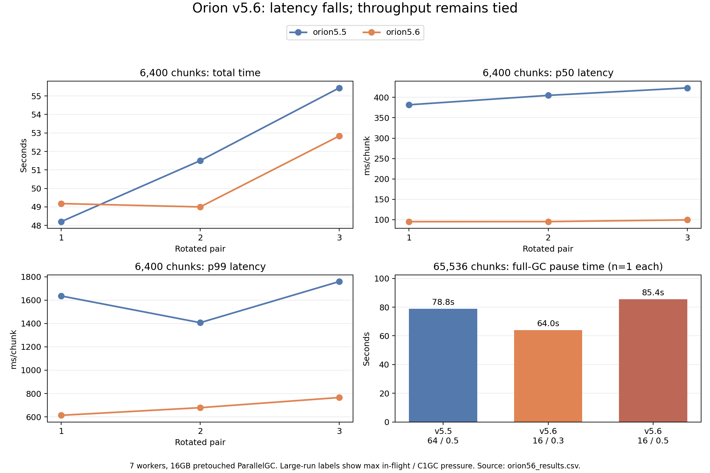
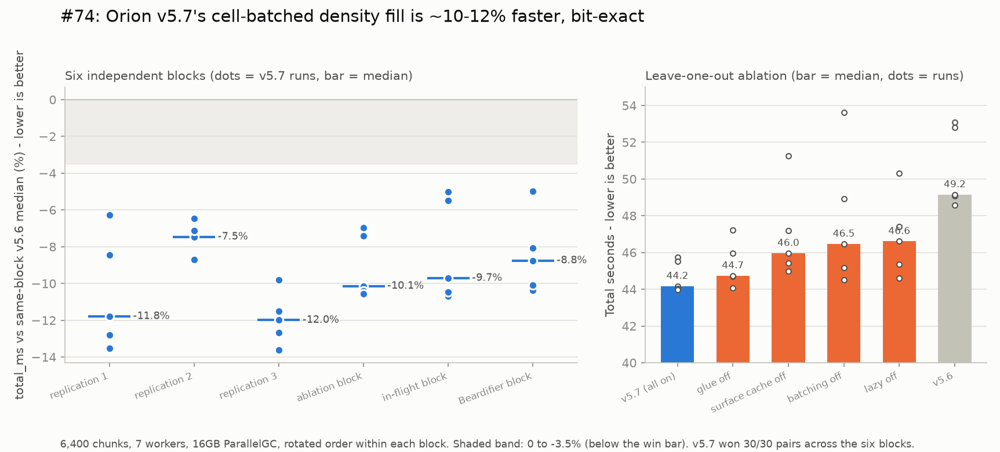
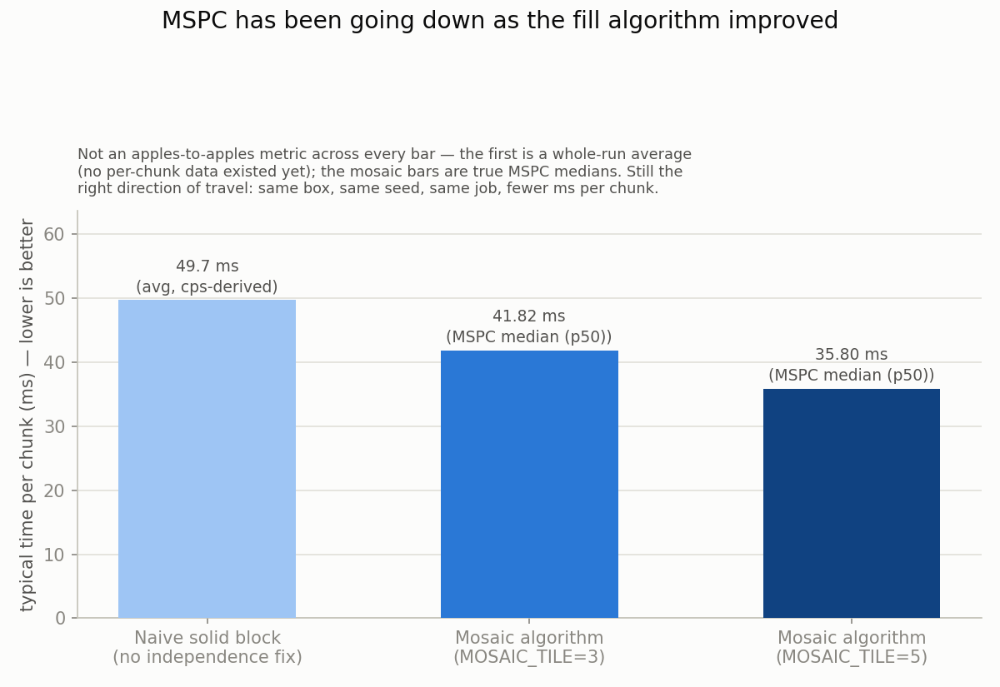
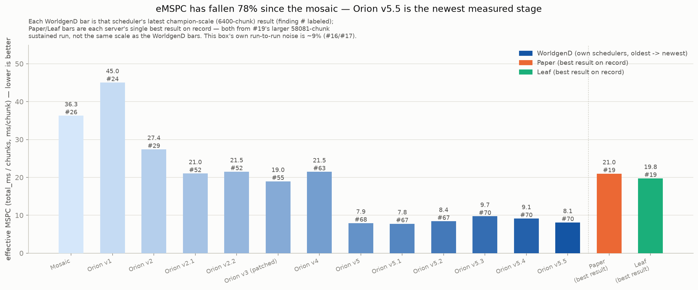

# WorldgenD

Headless, real-vanilla Minecraft chunk generation. No network, no RCON, no tick loop:
Mojang's own `DedicatedServer` is reflectively opened far enough to call `loadLevel()` and then
`ServerChunkCache.getChunkFuture(x, z, FULL, true)` directly, in parallel, using only the
official server jar.

WorldgenD's compiled classes contain **zero references** to any `net.minecraft.*` or
`com.mojang.*` symbol. Every Mojang class is a string literal fed to `Class.forName` at runtime
against a jar *you* provide. Delete the jar and WorldgenD is an inert pile of reflection glue.
See [`TUTORIAL.md`](TUTORIAL.md) for the how and why.

## Requirements and setup

- The official Mojang dedicated server jar, legally obtained by you. Not bundled, not compiled
  against, not checked in (`/servers/*.jar` is gitignored).
- Java 25 (the build pins `jvmToolchain(25)`).

Put the jar (or a symlink) at `servers/mojang-26-1-1-server.jar`. That's the whole install.

## Running

```
./gradlew run
```

The default `mosaic` scheduler fills a gapless 96x96 block (9216 chunks) tiled across 256
phases, each provably independent (see `scientific-findings-1-40.md` #7-#8). Every run ends with:

```
Done: 9216 chunks generated, 0 failed in NNms across 256 phases (fastest=NNms, slowest=NNms).
MSPC (ms/chunk, n=9216): min=NN p1=NN p25=NN p50=NN p75=NN p99=NN max=NN
```

**MSPC** is milliseconds per chunk (submission to completion), reported as a percentile spread
instead of one misleading average. Smaller is better. Formal definition: `scientific-findings-1-40.md` #11.

Options (all inert when omitted):

- `-Dscheduler=mosaic|orion|orion2|orion2.1|orion2.2|orion3|orion4|orion5|orion5.1|...|orion5.7`
- `-Dworldgen.seed=<signed 64-bit>` (default `69`)
- `-Dworldgen.progress=true` for machine-readable progress lines, or `-Dworldgen.progressfile=<path>`
- `-PmaxBgThreads=N` caps `Util.getMaxThreads()`. It is a ceiling: `clamp(cpus - 1, 1, N)`
  (`scientific-findings-1-40.md` #13)
- `-PgcArgs="-Xms16g -Xmx16g -XX:+AlwaysPreTouch -XX:+UseZGC"` passes raw JVM flags. GC choice
  and worker count interact (#14, #15)

## Schedulers

| Generator | Adds | Measured effective MSPC | Current reading |
|---|---|---:|---|
| Orion v4 | thread-safe structure generation | 20.68-20.80 | serial worldgen lane remains the ceiling |
| Orion v5 | parallel chunk-generation steps | 8.16-8.65 | removes that ceiling; matches Moonrise at seven workers |
| Orion v5.1 | SIMD density batches | 7.77-8.25 | isolated SIMD win, full-generation effect inside noise |
| Orion v5.2 | optimized ImprovedNoise kernel | 8.05-8.40 | Perlin CPU share falls; full-generation effect inside noise |
| Orion v5.3 | allocation-pressure fixes | 7.87-9.34 | bit-exact, real GC-frequency drop, no confirmed throughput win |
| Orion v5.4 | C1GC bounded chunk reclamation | 8.66-9.17 (6,400 chunks), 8.75 (256x256) | fixes a large-tile hang/OOM; cost inside noise after batching fix |
| Orion v5.6 | v5.5 compute patches, 16-chunk admission, earlier C1GC trigger | 7.87 (6,400 chunks), 7.93 (65,536) | 76% lower p50 and 57-70% lower p99 than v5.5; total time at parity |
| Orion v5.7 | v5.6 + cell-batched density fill, lazy interpolators, shared surface cache | 6.80-6.94 (6,400 chunks) | 10-12% lower total time than v5.6 (30/30 pairs, bit-exact) |

The engine defaults to `mosaic`; the current best is **v5.7**. The harness defaults to v5.1
(`../harness/src/config.rs`).

- **v4** is v3 plus a ported structure-generator thread-safety fix (`-Dorion.patchStructureGenState=true`,
  needs `-Dorion.patchReentrancy=true`). Findings #56. A density-function compiler prototype
  (`-Dorion.patchDfc=true`) is opt-in and not a confirmed win (#59-#61).
- **v5** (#62) is the architectural jump, about 2.5x faster than v4. Vanilla runs every generation
  step through one `ConsecutiveExecutor`; the agent patch (`-Dorion.patchParallelSteps=true`) moves
  steps onto the background pool under Moonrise-style area locks. Requires
  `-Dorion.patchReentrancy=true -Dorion.patchStructureGenState=true -Dorion.patchParallelSteps=true`.
  At 7 workers it is at parity with Paper, Leaf, and Leaf-on-crack (#63, #64). Deterministic feature
  scheduling is `-Dorion.deterministicFeatures=region` (#65, corrected by #66).
- **v5.1** adds SIMD batches (`jdk.incubator.vector`; `run_direct.py` and the harness enable it).
  `-Dorion.simd=scalar` selects the scalar control. Rounding order matches vanilla (#66).
- **v5.2** adds an optimized `ImprovedNoise` kernel, bit-exact; throughput tie with v5.1 (#67).
- **v5.3** patches four allocation-pressure sites (`-Dorion.patchAllocations=true`, auto-enabled).
  Young-GC count fell 28% but throughput is a wash (#68).
- **v5.4** adds C1GC, which moves each chunk `ACTIVE -> QUARANTINED -> COLLECTIBLE -> DETACHED -> PERSISTED`
  and writes it to a real `.mca` file. The 256x256 mosaic that hung under v5.3 finishes in 9.56 min.
  Batching ticket removals (`BATCH_SIZE = 64`) fixed a 40% CPU distance-graph-settle cost (#69,
  `c1gc/README.md`).
- **v5.5** makes C1GC conditional on old-gen pressure (`-Dorion.c1gc.pressure`, default `0.5`),
  reclaims on the poll thread, writes LZ4, and adds a `WorldGenRegion.getChunk` memo (#70).
- **v5.6** defaults to `-Dorion.maxinflight=16` and `-Dorion.c1gc.pressure=0.3`.
  `-Dorion.telemetry=true` writes `orion_telemetry.log`. Data in `findings/orion56_results.csv` (#73).



- **v5.7** swaps v5.1's SIMD batches for the noise-cell patch (`DensityCellPatch`): whole 128-element
  cells filled in a loop, interpolators updated only when read, preliminary surface levels shared
  across chunks. Ablation flags: `-Dorion.noiseCell.batch|lazy|surfaceCache|glue` (default true).
  See #74, and #75 for the six hypotheses that did not make it.



Orion v2.1 uses raster target order; v2.2 is the scatter-ordered variant.

## Progress



Across every scheduler generation, **effective MSPC** (`total_ms / chunks`) has fallen roughly 78%
from the original mosaic to Orion v5.5. Paper and Leaf's best real-server results are plotted for scale.



The full experiment log (GC comparisons, JFR profiles, Paper/Leaf head-to-heads, MC-55596) is in
`scientific-findings-1-40.md` and `scientific-findings-41-80.md`.

## Leaderboard

Every scheduler plus real Paper, Leaf, and Leaf-with-crack-flags, ranked by effective MSPC, one
row per individual run (31 total), generated from `findings/leaderboard_entries.csv`:

```
python3 findings/generate_leaderboard.py   # regenerates findings/leaderboard.html
```

It is not a rigorous ranking: rows span different sessions and box states, and run-to-run noise
is ~9% (#16, #17, #32). The rigorous version is `scientific-findings-1-40.md` #1-#35 and
`cursed-scientific-advancements.md`.

## Project layout

Sources live under `src/main/kotlin/io/github/eath1283/worldgend/` (plus `src/main/java/...` for the
vector and cell kernels). See [`ARCHITECTURE.md`](ARCHITECTURE.md) for how the pieces fit together.

| Path | What it is |
|---|---|
| `HeadlessWorldgen.kt` | The whole heist: bootstrap replay, `DedicatedServer` construction, scheduler selection, the fill loop, result file, MSPC instrumentation |
| `ServerRuntime.kt`, `Reflect.kt` | Finds the server jar and builds the `URLClassLoader`; thin reflection helpers (`Mc`) |
| `Orion.kt`, `OrionV2.kt`, `OrionV2_1.kt`, `OrionV2_2.kt`, `OrionV3.kt` | Frontier schedulers v1-v3 (conflict-checked admission). Kept as benchmark baselines |
| `OrionV5.kt`, `OrionParallelSteps.kt` | Current scheduler: dispatches chunks and runs vanilla's generation steps on a worker pool (v4 is v3 plus the structure-gen patch) |
| `OrionPatchAgent.kt` | Java agent (`Premain-Class`): javassist patches selected per `-Dscheduler` and `-Dorion.patch*` flags |
| `DensityCellPatch.kt`, `DensitySimdPatch.kt`, `ImprovedNoisePatch.kt`, `AllocationPatch.kt` | Compute patches: v5.7 cell fill, v5.1 SIMD batches, v5.2 Perlin kernel, v5.3 allocation fixes |
| `RegionChunkMemo.kt`, `MemoizingPredicate.kt` | Lookup memos (`WorldGenRegion.getChunk`, biome-condition tests) |
| `LightSwapPatch.kt` | Opt-in light-engine instrumentation (`-Dorion.lightSwap`); experiment closed by finding #77 |
| `ChunkEvictor.kt`, `c1gc/` | Chunk reclamation: v5.4-era evictor and the C1GC lifecycle that replaced it (see `c1gc/README.md`) |
| `PendingSpatialIndex.kt`, `HeldCenterIndex.kt`, `OrionTelemetry.kt` | Admission indexes and the `-Dorion.telemetry` event log |
| `Dfc.kt`, `DfcRuntime.kt` | Density-function compiler prototype, parked at Stage 1 (finding #58) |
| `*.java` | `DensityBatch`/`DensityVector` (SIMD), `DensityCell*`/`DensitySurfaceCache` (v5.7), `BlockStateSnapshot` |
| `src/test/` | Unit tests for the kernels, snapshotting, and the v5 failure path |
| `run_direct.py` | Direct launcher: adds the Vector API module, rebuilds the agent, runs a scheduler |
| `wrapper/` | `worldgend-wrap.jar` / TUI front end for end users (own README) |
| `landing-page/` | Vite site deployed by `.github/workflows/landing-page.yml` |
| `TUTORIAL.md` | The narrative: what this does and why it works, written for a human |
| `ARCHITECTURE.md` | Runtime map: scheduler, patches, C1GC, and the hard-won gotchas |
| `findings/` | Raw data (`mspc_results.csv`, `algorithm_progress.csv`, `gc_results.csv`, ...), JFR profiles, and the matplotlib scripts (`plot_results.py`) behind every chart |
| `findings/leaderboard_entries.csv`, `findings/generate_leaderboard.py` | Source and generator for `findings/leaderboard.html`, the sortable cursed leaderboard |
| `cursed-scientific-advancements.md` | The highlight reel: the whole Orion arc, same receipts, deliberately unhinged tone |
| `moonrise-diff-findings.md` | Comparison against Paper's Moonrise scheduler |

## Docs

- **[`ARCHITECTURE.md`](ARCHITECTURE.md)** — how the runtime fits together, and the
  gotchas that cost real debugging time.
- **[`TUTORIAL.md`](TUTORIAL.md)** — start here. How the reflection heist works, step by
  step, and the ground rules that keep it correct (`managedBlock()` is load-bearing, the
  seed is pinned to `69`, etc).
- **[`scientific-findings-1-40.md`](scientific-findings-1-40.md)** and
  **[`scientific-findings-41-80.md`](scientific-findings-41-80.md)** — the evidence. Thread-pool sizing,
  the confirmed radius-8 chunk dependency ceiling (straight out of the jar's bytecode), the
  mosaic algorithm it justifies, the MSPC metric, and an open-questions list for anyone
  picking this up next.

## Legal

Not one byte of Mojang's compiled game ships in this repo or its build output. The jar lives
in a directory you control, is read at runtime, and is never redistributed. This is a remote
control, not a copy of the TV.
