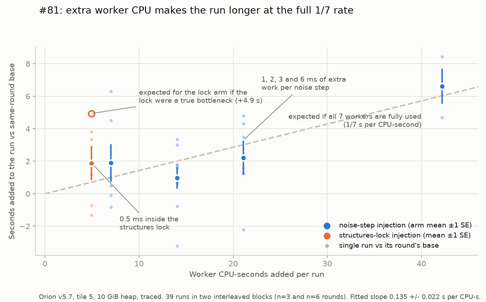
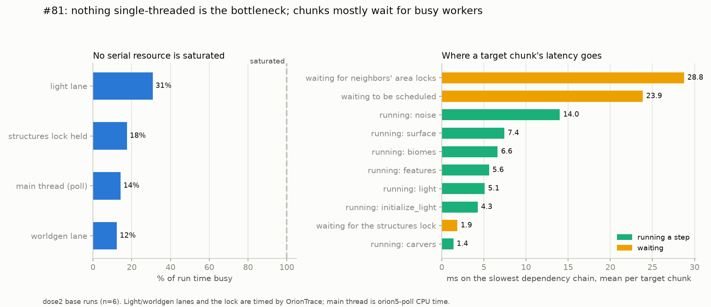
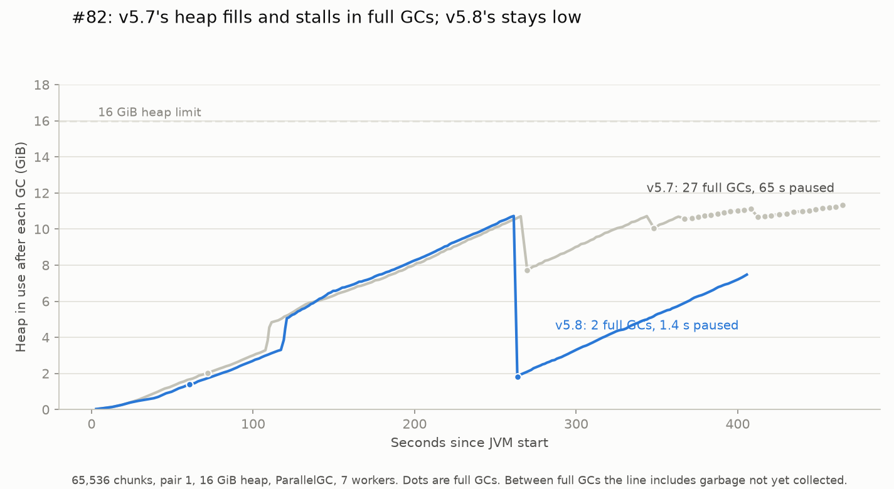
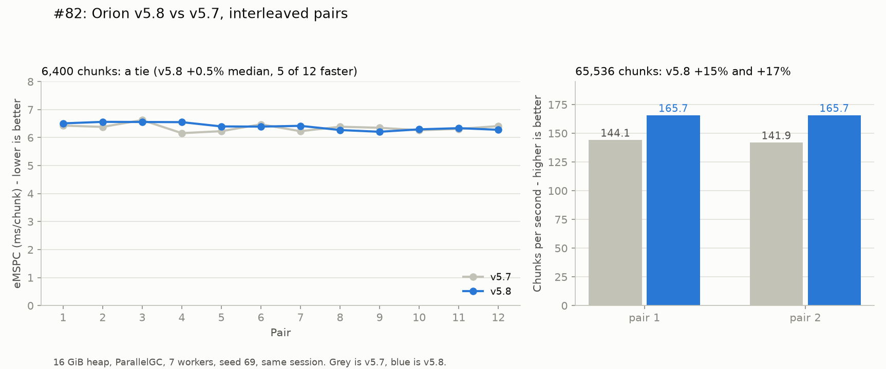
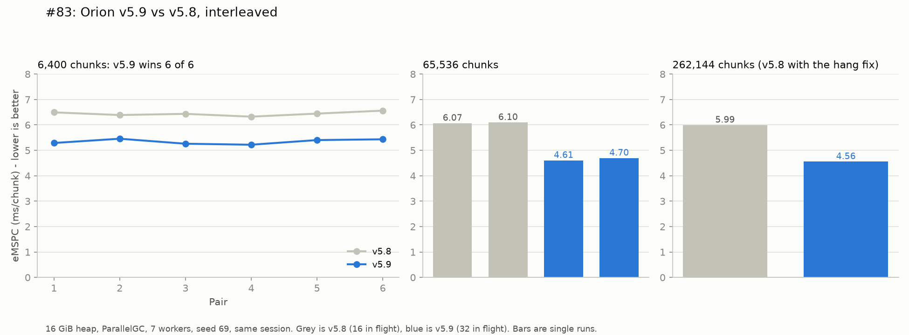
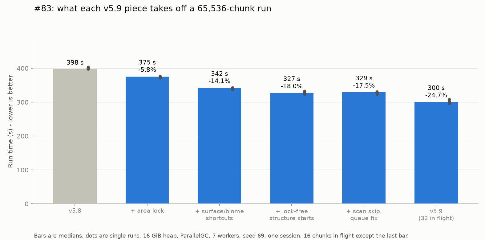

# WorldgenD: Findings #81-120

**Continuation from [`scientific-findings-41-80.md`](scientific-findings-41-80.md).** Same methodology. Seed `69`, hardcoded, every run.

From here on, each entry leads with the plain answer and keeps exact flags and file paths in a **Method** block at the end.

---

## 81. Why CPU savings seemed not to shorten the run: they do, but the "invisible" wins never saved CPU

**Short answer.** Orion v5.7 is limited by how much work its 7 workers have to do. Every extra
CPU-second of worker work adds about 1/7 of a second to the run, the most it can cost with 7
workers. No single-threaded part of the pipeline is close to full. So any change that really
cuts worker CPU will shorten the run in proportion.

The earlier optimizations that "saved CPU but didn't speed anything up" mostly did not save CPU
in the first place. Their savings came from profiler sample shares or from flawed timing, not
from measured worker CPU.

### The question

Several past changes looked like clear CPU wins on a profile but did not move total time: the
Perlin port (#67), the allocation fixes (#68), and the `mapAll` memo (#75). One explanation was
that the run is held up by something single-threaded (a lock, a lane, the main thread) rather
than by the workers. If so, worker CPU savings would be soaked up by waiting and never show.

### What we did

1. **Traced every run.** For every chunk step we recorded when it was requested, when it could
   start, when it actually started, and when it finished. We also timed how busy each
   single-threaded part was: the light lane, the worldgen lane, the main thread, and the global
   structures lock.
2. **Added CPU on purpose.** This is the direct test. A worker spins for a fixed amount of CPU
   time inside every noise step (1, 2, 3 or 6 ms). If the run has slack, the extra work
   disappears into it and total time barely moves. If the workers are the limit, total time grows
   by the added CPU divided by 7.
3. **Added CPU inside the structures lock.** A 0.5 ms spin is placed while that lock is held. If
   the lock is a true bottleneck, every millisecond there adds a full millisecond to the run.

Every arm ran interleaved with a plain baseline in the same rounds (39 runs at 6,400 chunks).

### Result 1: extra worker CPU costs the full 1/7



| Extra work | Added worker CPU per run | Runs | Extra run time (mean ± SE) | Expected if workers are the limit |
|---|---:|---:|---:|---:|
| 1 ms per noise step | 7.0 s | 6 | +1.90 ± 1.16 s | +1.0 s |
| 2 ms per noise step (block 1) | 14.1 s | 3 | +0.84 ± 0.82 s | +2.0 s |
| 2 ms per noise step (block 2) | 14.1 s | 6 | +1.04 ± 0.97 s | +2.0 s |
| 3 ms per noise step | 21.1 s | 6 | +2.21 ± 1.06 s | +3.0 s |
| 6 ms per noise step | 42.2 s | 3 | +6.61 ± 1.08 s | +6.0 s |

- A straight-line fit gives **0.135 ± 0.022 s of run time per added CPU-second** (about 1/7.4).
  The full-saturation value for 7 workers is 1/7 (0.143).
- The spin adds the CPU it claims: measured worker CPU rose 1.08 s per injected CPU-second.
- Small doses sit on the same line within their error bars. There is no flat "free" region at
  the start, so there is no slack for small savings to vanish into.
- The 65 runs from #74 tell the same story without any injection. Total time rises 1/7.0 s per
  extra worker CPU-second, correlation 0.98.

### Result 2: nothing single-threaded is the bottleneck



- **Single-threaded parts are mostly idle.** The light lane is busy 31% of the time, the
  structures lock is held 18%, the main thread 14%, the worldgen lane 12%.
- **Workers are nearly full.** On average 5.6 of 7 workers are running code and about 0.6 are
  parked waiting for the structures lock. That leaves under one worker's worth of idle time.
- **A requested chunk takes about 108 ms.** Most of that is waiting rather than working: about
  29 ms waiting for neighbors to release their area locks, 24 ms waiting to be scheduled, and
  the rest running steps (noise is the biggest at 14 ms). These waits are what queueing looks like
  when workers are busy. They are not a fixed delay.
- **The numbers add up.** With 16 chunks in flight at 108 ms each, 6,400 chunks should take
  43.0 s. The six baseline runs averaged 43.3 s.

### Result 3: the structures lock is a partial exception

The 0.5 ms spin inside the structures lock added 4.9 s of lock-held time per run. Total time
rose **1.88 ± 1.05 s**. That is more than spreading the same CPU over 7 workers would cost
(+0.7 s), and much less than a true bottleneck would cost (+4.9 s).

The reason is that workers wait for this lock by parking, and a parked worker can't do anything
else. Lock waiting rose from 25 to 40 worker-seconds, so each extra second of holding the lock
kept about 3 workers parked. The lock is not the run's limit, but it costs more than its own CPU.

### Result 4: the old "invisible" wins, re-read

| Change | What was reported | Did worker CPU actually drop? | Reading now |
|---|---|---|---|
| `mapAll` memo (#75) | "removes ~18 thread-s of constructor time" | No: 284.2 vs 285.7 worker CPU-s in its own A/B | The 18 s came from comparing against an instrumented baseline its author flagged as inflated. No CPU was saved, so nothing to see. |
| Perlin port (#67) | `ImprovedNoise.p` fell from 10.6% to 0% of samples | Not measured | A profiler share can fall while total CPU stays the same (work moves to the caller). The wall-time tie is consistent with no net saving. |
| Allocation fixes (#68) | Fewer young GCs | Not measured | An allocation change, not a CPU change. #77 already showed allocation is not the lever. |
| Surface/biome shortcuts (#75) | 3.5-4.5% less worker CPU | Yes | Total time moved -3.7% (n=16), exactly what 1/7 predicts. It was under-powered for the 3-4% bar, not invisible. |

### What this means

- **Judge compute changes by measured worker CPU-seconds.** Profiler sample shares can't show
  whether total CPU went down. The trace now records worker CPU on every run.
- **Expect to need many pairs.** In this session a baseline run varied by about 3% run to run,
  so one pair's difference varies by about 4.5%. Confirming a real 3% win takes roughly 20-30
  interleaved pairs, not 5-10.
- **The big targets are still the big CPU users.** Noise, surface and biomes cover most of a
  chunk's working time. Scheduler tricks can't buy much, because there is under one idle worker
  to recover.
- **The structures lock is the one structural lever left.** It ties up about 0.6 workers in
  parking. #75's lane experiment found the freed workers had nothing else ready to do, so the
  win is unproven, but a finer-grained lock remains the only place where scheduling might help.

### Caveats

- **Heap was 10 GiB, not the 16 GiB champion spec.** A Minecraft server elsewhere on the VM held ~16 GB,
  so a 16 GiB pretouched heap was OOM-killed. Tile 5 peaks at ~1.6 GB of old gen. Every comparison
  here is within this study only.
- **Tracing is on in all study runs.** Four traced/untraced pairs showed no measurable cost
  (42.37 s vs 42.33 s mean).
- **A spin is not real code.** It uses CPU but doesn't allocate or touch memory. A real change
  can also shift GC or cache behavior, which a spin can't imitate.

### Method

Orion v5.7, tile 5 (6,400 chunks), 7 workers, seed 69, Corretto from `/root/minecraft-server/runtime/java`,
2026-11-09. Common flags:

```text
-Xms10g -Xmx10g -XX:+AlwaysPreTouch -XX:+UseParallelGC -Dmax.bg.threads=7
-javaagent:build/libs/orion-agent.jar -Dorion.patchReentrancy=true
-Dorion.patchStructureGenState=true -Dorion.patchParallelSteps=true
-Dscheduler=orion5.7 -Dorion.maxinflight=16 -Dorion.c1gc.pressure=0.3
-Dorion.trace=<prefix>   (all study runs)
-Dorion.inject=noise:1000 | noise:2000 | noise:3000 | noise:6000 | structure_starts:500
```

- New code: `OrionTrace.kt` (tracing and injection), hooks in `OrionParallelSteps.kt` and `OrionV5.kt`,
  and an agent patch timing `AbstractConsecutiveExecutor.run` for lane busy time.
- Runner: `findings/run_critpath.py` (blocks `dose1`: 3 rounds; `dose2`: 6 rounds; arm order
  reversed every other round). Overhead pairs: tags `ovh_t1-4` / `ovh_n1-4`.
- Analysis: `findings/critpath_analysis.py` (utilization and waits), `findings/critpath_dag.py`
  (rebuilds the step dependency graph from vanilla 26.1.1's requirement radii and follows each
  chunk's slowest dependency back to its request), `findings/collect_critpath81.py` writes
  `findings/critpath81_runs.csv` and `findings/critpath81_attribution.csv`.
- The CPU-vs-time line for #74 uses `findings/orion57_runs.csv` (65 runs with worker CPU recorded).
- Raw traces (~200 MB) stay local under `findings/critpath_runs/` and are gitignored. Results
  files and the summary CSVs are kept.
- Rows: `orion_results.csv` configs `cp81_*`. On the leaderboard, baseline runs are filed as
  Orion v5.7 and injected runs as Experiment.

---

## 82. Orion v5.8: every generated chunk was being kept in memory forever; fixing it makes long runs 13-14% faster

**Short answer.** Vanilla hands the server thread a small follow-up task for every chunk. A real
server runs those tasks between ticks. WorldgenD never ticks, so the tasks were never run, and each
one kept its whole chunk in memory. Over a long run the heap filled up and the JVM spent about a
minute stuck in back-to-back full garbage collections.

Orion v5.8 is v5.7 plus one change: the poll thread now runs those tasks as they arrive. At 65,536
chunks it finishes **13.0% and 14.4% sooner** in two interleaved pairs (165.7 vs 144.1 and 141.9
chunks per second). At 6,400 chunks nothing changes, because the heap never gets full enough to matter.
Generated blocks are identical.

### How it was found

The 65,536-chunk run in #80 had 31 full GCs, 27 of them in the last 100 seconds. After each one
about 11 GB was still in use, even though C1GC reported every chunk as written to disk and released.

A heap dump taken partway through a run showed why. Of the 3,904 chunk noise objects still alive,
3,353 (86%) were reachable through the same chain:

```text
server task queue -> queued task -> ServerLevel.onStructureStartsAvailable -> ProtoChunk -> NoiseChunk
```

Each queued task holds the chunk's working copy (`ProtoChunk`). That copy holds the noise caches
used to build it, and it shares its block storage with the finished chunk. So nothing C1GC released
could actually be freed. The cost was about 180 KB per chunk, for every chunk ever generated.

Vanilla only runs a queued server task when the current tick has time left. With no tick loop that
is never true. The same queue also carries point-of-interest updates (village beds, job sites),
so those were never applied either.

### The fix

Before the fill starts, v5.8 tells the server its next tick is infinitely far away. From then on
vanilla's own check says "there is time", and the poll thread, which already calls the server's task
poll in its loop, runs each task within moments of it being queued. No scheduling logic changed,
which is why this is v5.8 and not v6.

### Result 1: memory stays low



| At 65,536 chunks (mean of 2) | v5.7 | v5.8 |
|---|---:|---:|
| Tasks left in the queue at the end | 79,042 | 0 or 1 |
| Still in use after the last full GC | 11.6 GB | 1.9 GB |
| Full GCs | 30 | 5 |
| Time paused in full GCs | 66.0 s | 1.4 s |
| JVM CPU time | 3,058 s | 2,599 s |

Three of the full GCs in each column happen during startup, before generation begins.

In a separate 16,384-chunk check (10 GiB heap, reclamation always on), memory in use went from
1.2 GB to 2.7 GB between the 62 s and 103 s marks on v5.7. On v5.8 it went from 948 MB to 983 MB.

v5.8's heap still climbs between full GCs. That is ordinary garbage waiting to be collected: chunks
live long enough to be moved to the old part of the heap before they are released. One cheap full
GC (about 0.7 s) clears it.

### Result 2: long runs are faster, short runs are unchanged



| Size | Version | Runs | Median time | ms per chunk | Chunks per second |
|---|---|---:|---:|---:|---:|
| 6,400 | v5.7 | 12 | 40.74 s | 6.366 | 157.1 |
| 6,400 | v5.8 | 12 | 40.93 s | 6.396 | 156.4 |
| 65,536 | v5.7 | 2 | 458.4 s | 6.994 | 143.0 |
| 65,536 | v5.8 | 2 | 395.5 s | 6.035 | 165.7 |

- **6,400 chunks: a tie.** Across 12 pairs v5.8 is +0.5% (median), 5 of 12 faster, with a
  standard error of 0.76%. Young-GC pause time does fall from 0.92 s to 0.62 s per run, but that
  is under 1% of the run.
- **65,536 chunks: 13.0% and 14.4% less time.** The time saved (59 s and 66 s) matches the full-GC
  pause time removed (64 s and 65 s). Nothing else got faster.
- **Slow chunks are less slow.** The 99th-percentile chunk time at 65,536 chunks drops from about
  800 ms to about 375 ms, because chunks no longer wait behind 2-second pauses.
- **The gap should widen with size.** v5.7 needs about 180 KB of heap per chunk generated, so a
  16 GiB heap runs out somewhere past 65,536 chunks. v5.8 has no such limit in these runs, but
  sizes beyond 65,536 were not tested.

### Correctness

With deterministic ordering on, v5.7 and v5.8 produce the same SHA-256 for every chunk: 0 of 2,304
differ, checked with two runs of each. The target was shifted 100 chunks away from spawn. Chunks
next to spawn differ between any two runs of the same version (33 of 2,304 on v5.7 against itself),
because they are generated during startup before ordering is switched on (#65).

### What this changes about earlier findings

- **C1GC (#69-#73, #80) was tuned against a heap that could not shrink.** Its bookkeeping was
  correct, but the memory it released stayed reachable through the task queue. The "full GCs remain
  after reclamation" result in #73 and #80 was this leak.
- **The young-GC pause climb in #76 and #77** tracked the amount of live memory. That memory was
  mostly these retained chunks.
- **Saved worlds from v5.7 and earlier may be missing point-of-interest data**, since those updates
  were never applied. This was not checked.

### Caveats

- **Two large pairs.** Both agree closely (v5.8: 395.6 s and 395.5 s), but it is still n=2.
- **Memory is not perfectly flat.** The 16,384-chunk check shows about 5 KB per chunk of slow growth
  left, mostly entities and small per-chunk tables. That would be about 1.3 GB at 262,144 chunks.
- **The reclamation threshold was left alone.** C1GC still switches on when the old part of the heap
  is 30% full, which now mostly measures uncollected garbage. Whether it should switch on later, or
  at all on a 16 GiB heap, was not tested.

### Method

Orion v5.7 and v5.8, 7 workers, seed 69, Corretto from `/root/minecraft-server/runtime/java`,
2026-11-10, one session. Common flags:

```text
-Xms16g -Xmx16g -XX:+AlwaysPreTouch -XX:+UseParallelGC -Dmax.bg.threads=7
-javaagent:build/libs/orion-agent.jar -Dorion.patchReentrancy=true
-Dorion.patchStructureGenState=true -Dorion.patchParallelSteps=true
-Dorion.maxinflight=16 -Dsaveworld=false
-Dscheduler=orion5.7 | orion5.8      -Dmosaic.tile=5 | 16
```

- The change: `HeadlessWorldgen.kt` sets `MinecraftServer.nextTickTimeNanos` to `Long.MAX_VALUE`
  before `fill()`. `-Dorion.serverTasks=drain|hold` overrides it on any v5 scheduler (default
  `drain` on v5.8, `hold` otherwise). The result file's `serverTasks` line reports the mode and how
  many tasks were still queued when the fill ended.
- Runner: `findings/run_orion58.py` (arm order reversed every other round; fresh JVM and world per
  run). Blocks `short` (12 rounds, tile 5) and `large` (2 rounds, tile 16).
- Collection: `findings/collect_orion58.py` writes `findings/orion58_runs.csv` and
  `findings/orion58_heap.csv` (one row per GC of the large runs). Rows in `orion_results.csv` are
  configs `o58_*`.
- Heap dump: `jcmd <pid> GC.heap_dump` at about 3,000 of 6,400 chunks, 6 GiB heap, reclamation
  always on. `findings/HprofPath.java` prints the chains that keep a given class alive.
- Correctness runs: tile 3, `-Dorion.deterministicFeatures=region -Dorion.patchWorldgenLight=true
  -Dorion.parallelSteps.verify=true -Dorion.targetShift=100 -Ddescribe.histogramfile=<path>`.
- Raw GC logs and progress files stay local under `findings/orion58_runs/` and are gitignored.

---

## 83. Orion v5.9: long runs are 24% faster, and a vanilla queue race that could stall a chunk for minutes

**Short answer.** Orion v5.9 generates 65,536 chunks in a median **300 s, against 398.5 s for
v5.8 (24.7% less time)**. In the final interleaved block it was 304.8 s vs 398.6 s. Every block
and biome is identical to v5.8. At 6,400 chunks it is **17.3% faster** (6 of 6 pairs, median
34.2 s vs 41.2 s). At 262,144 chunks it takes **1,194 s
instead of 1,571 s (24.0% less time)**: 4.56 ms per chunk against 5.99, 219.5 chunks per second
against 166.9. The 262,144-chunk v5.8 run needed the hang fix described below to finish at all.



v5.9 stacks seven changes. Four are speedups, two fix hangs that v5.8 also has, and one is a
32-chunk admission window:

| Piece | What it does | 65,536-chunk run time (median) |
|---|---|---:|
| v5.8 | starting point | 398.5 s |
| + area lock | a step starts as soon as its own square is free, instead of queueing behind unrelated waiters | 375.5 s (−5.8%) |
| + surface/biome shortcuts | the five exact shortcuts from #75, never shipped | 342.2 s (−14.1%) |
| + lock-free structure starts | structure starts and references stop taking the global structures lock | 326.8 s (−18.0%) |
| + region scan skip, queue fix | no measurable speed change; the queue fix removes the stall | 328.7 s (−17.5%) |
| v5.9 (32 in flight) | the window is now worth widening | 300.2 s (−24.7%) |



### Why earlier attempts missed these

Three of these pieces were tried before, one at a time, and filed as nulls or left unshipped:

- lock-free structure starts (#75: −0.9%);
- a 32-chunk window (#75: +0.1%);
- the surface/biome shortcuts (#75: −3.7%, not separable from noise).

They don't pay alone. The FIFO area lock made neighboring FEATURES steps run single file, so
freeing structure steps or admitting more chunks only added waiters. Once the area lock stops
the convoy, the same pieces show: at 6,400 chunks the full set is 17.3% faster, at 65,536
24.7%. The surface/biome shortcuts cut real worker CPU (#81's lever), and at 65,536 chunks they
take 8.9% off, the same in every run.

Each piece was first measured at 65,536 chunks, where runs last 5-7 minutes and the effects stand
well clear of run-to-run spread. **Screen scheduler changes at tile 16.**

### The pieces

**Area lock.** v5.8 gives every chunk a first-in-first-out queue. A FEATURES step (which writes
to its 3x3 neighbors) waits until it heads all nine queues. A step blocked by one neighbor also
blocks everything queued behind it on the other eight, even when those later steps don't touch
the busy neighbor. Neighboring FEATURES steps end up running single file. v5.9 starts any step
whose square is free. A step that has been passed over 16 times reserves its square, so nothing
waits forever. In a traced 6,400-chunk run, FEATURES steps spent 57 s waiting for their squares
instead of 222 s (`orion.areaLock=greedy|fifo`).

**Surface/biome shortcuts.** Ported unchanged from the stages worktree behind #75: cached climate
noise for biomes, a uniform-corner biome check, direct section reads and writes in the surface
column, and skipping surface rules that provably cannot match. With
`-Dorion.stage.surfaceVerify=true` every shortcut is checked against the real rule:
1.66 billion shortcuts in a 65,536-chunk run, 0 mismatches (`orion.stage.<name>`).

**Lock-free structure starts.** Structure starts and references now run without the global
structures lock, as Moonrise (Paper) does. Placement during FEATURES and mob spawning still take
it. #75's version of this was a null at 6,400 chunks. The template palette cache is made
thread-safe (`orion.structureStarts=parallel|serial`).

**Region scan skip.** Blending asks whether any pre-1.18 chunk is nearby. The first ask per
region scans 1,024 chunk slots one disk call at a time, and every biomes or noise step near that
region waits for it. v5.9 first checks whether the region has any saved or pending chunk, and
skips the scan for an empty one. A new world skips all 100 regions. Run time did not measurably
change (−1.6% and −1.2% in two pairs, inside the spread of identical runs). It is kept because it
removes blocking waits on worker threads (`orion.oldChunkScan=skipEmpty|vanilla`).

**32 chunks in flight.** In #42, #73 and #75 the admission window was a latency dial and nothing
more. On v5.9 a wider window keeps 7.2 of 8 cores busy instead of 6.8. The trade-off is latency:
median chunk latency goes from 66 ms to 131 ms, p99 from 248 ms to 564 ms. Use
`-Dorion.maxinflight=16` when latency matters.

| v5.9 window | 65,536-chunk runs | Run time |
|---:|---:|---|
| 16 | 5 | 322.5-331.3 s |
| 24 | 1 | 314.0 s |
| 32 | 4 | 296.4-307.8 s |
| 48 | 1 | 298.9 s |
| 128 | 1 | 301.7 s |

### The stall: a vanilla race, now fixed

One window-64 run took 413.7 s. A single chunk sat unfinished for 281 s. It held back C1GC's
frontier, so nothing behind it could be released; the heap filled and the JVM spent about 30 s in
full GCs.

A new watchdog (`-Dorion.stallSeconds`, default 30) dumps the state around any chunk unfinished
after 30 s. In short window-64 starts it fired often: in 6 of 24 on v5.9, and also on v5.8 (2 of
6), so it predates v5.9. Every dump showed the same thing:

- the chunk had finished `initialize_light`, and all its neighbors were done;
- its generation task was waiting in vanilla's worldgen dispatcher queue, at priority level 35-44;
- the chunk's real level was 33, and level 33 never empties while a fill is running.

The cause is in vanilla. Each chunk has one "queue level" field. The worldgen and light
dispatchers both update it, each on its own thread, whenever the chunk's level changes. If the
light dispatcher applies an older change late, it briefly writes back a stale level. A generation
task submitted at that moment is filed under the stale level, and it starves until level 33
runs dry at the very end of the fill.

v5.9 patches the dispatcher's priority queue. Each queue remembers the levels it has applied
itself and files new tasks under that level; a level change also gathers the chunk's tasks from
every level (`-Dorion.dispatcherResort=allLevels|vanilla`). On the setting that stalled in 11 of
18 starts before, 0 of 8 stalled after. In a normal 65,536-chunk v5.9 run the fix catches about
700-790 stale submissions; the result file's `dispatcherResort` line counts them.

A real server ticks and clears the backlog every tick, so this race rarely matters there. In a
headless fill the backlog never clears.

### A second hang: the poll thread waiting on itself

The first 262,144-chunk v5.8 run stopped dead at 34,073 chunks and sat there until the
two-hour timeout. Every thread was idle. The poll thread, which runs all server-side tasks in
a headless fill, was waiting for a chunk:

- C1GC unloaded a chunk holding an Allay;
- removing the Allay's game-event listener asked for a chunk;
- the poll thread did not count as the server thread at that moment, so it queued the request
  as a server task and waited for it;
- only the poll thread runs server tasks.

Inside a server task the poll thread already counts as the server thread (#47). C1GC's unloading
runs between tasks, where it did not. v5.9 makes the poll thread count as the server thread for
the whole fill, as a real server's main thread does (`-Dorion.pollServerThread=true|false`,
on by default for v5.9 only). The 262,144-chunk v5.8 run below has the same fix switched on and
nothing else.

It takes an Allay at the edge of the unloaded area, so it is rare. The evidence for the fix is
indirect: one deadlock without it, and two complete 262,144-chunk runs with it. Nothing counts
how often the fixed path ran. It did not happen in any of
the 65,536-chunk runs. The fix costs nothing: two interleaved 65,536-chunk pairs of v5.8 with and
without it took 404.0/405.8 s and 405.3/402.8 s.

### Correctness

- **Blocks and biomes.** With deterministic ordering on, v5.9 matches v5.8 chunk for chunk:
  0 of 6,400 differ at tile 5 (at 16 and 32 in flight), and 0 of 2,304 at tile 3 for each piece
  as it landed. Biomes were compared with a separate per-cell digest (`-Ddescribe.biomefile`).
  The tile-5 check was rerun on the final jar, after the poll-thread fix: still 0 of 6,400.
- **Thread safety of lock-free structure starts.** Digests can't catch a rare race, so C2ME's
  worldgen threading fixes were checked one by one against vanilla 26.1.1:
  - stronghold static state is already per-thread (#56);
  - the template palette cache is now synchronized;
  - piece flags (temple chests, spawners, mansion matrix) are only written during placement,
    which still takes the lock;
  - the structure check cache is only used by `/locate`;
  - template loading goes through a `ConcurrentHashMap`;
  - the Nether fortress fixes are Nether-only.

### Caveats

- **Window 16 is still the latency choice.** p99 chunk latency more than doubles at 32 in flight.
- **The harness defaults to 32 in flight for v5.9.** A value already tuned away from the old
  scheduler's default is kept when switching.
- **8 workers did nothing**, on v5.8 or v5.9, at 6,400 or 65,536 chunks. The box has 8 vCPUs, and
  the poll, GC and IO threads use the eighth.
- **The 5-35% slowdown inside a 65,536-chunk run is terrain.** It sits at the same chunks on every
  version, and with reclamation on from the start.
- **Both hangs exist in v5.8.** The 262,144-chunk v5.8 run uses `-Dorion.pollServerThread=true`.
- **The queue race exists in vanilla.** It was found with Orion's tools; whether it shows up on a
  ticking server under heavy load was not tested.

### Method

Orion v5.8 and v5.9, 7 workers, seed 69, Corretto from `/root/minecraft-server/runtime/java`,
2026-11-11, one session. Common flags:

```text
-Xms16g -Xmx16g -XX:+AlwaysPreTouch -XX:+UseParallelGC -Dmax.bg.threads=7
-javaagent:build/libs/orion-agent.jar -Dorion.patchReentrancy=true
-Dorion.patchStructureGenState=true -Dorion.patchParallelSteps=true -Dsaveworld=false
-Dscheduler=orion5.8 | orion5.9      -Dmosaic.tile=5 | 16 | 32
```

- Runner: `findings/run_orion59.py` (arm order reversed every other round; samples every JVM
  thread's CPU once a second into `<label>.cpu.csv`). The runner pins 16 in flight; v5.9 arms at
  the shipped default add `-Dorion.maxinflight=32`.
- Blocks, in order: `lev`, `scale` (6,400 chunks); `long`, `l16`, `ab16`, `pss16`, `scan16`,
  `win16`, `win16b`, `fin16` (65,536 chunks); `fin5` (6,400 chunks); `big` (262,144 chunks);
  `fix16` (65,536 chunks, v5.8 with and without the poll-thread fix). v5.8 ran about 1.5%
  slower in `fix16` than earlier in the session, so compare within a block; `fix16` is filed as
  Experiment and stays out of the v5.8 medians.
  `fin16` and `fin5` are the final blocks, on the shipped jar.
- The poll-thread fix landed after the 65,536-chunk blocks, so those v5.9 runs do not have it.
  It only changes what runs on the poll thread between server tasks. A 6,400-chunk smoke run with
  it took 33.6 s (the `fin5` v5.9 median is 34.2 s), and the 262,144-chunk v5.9 run has it.
- Runs abort after 600 s without progress. The deadlocked run's dump is
  `findings/orion59_runs/bigdead_v58_r1.stall.txt`.
- Stall hunts: `findings/hunt_stall59.py` (short tile-16 starts at 64 in flight, stopped at 70 s
  of fill unless the watchdog fires). Dumps under `findings/orion59_runs/hunt*/`.
- Digests: `findings/check_orion59.py` (`-Dorion.deterministicFeatures=region
  -Dorion.patchWorldgenLight=true -Dorion.parallelSteps.verify=true -Dorion.targetShift=100`).
- Collection: `findings/collect_orion59.py` writes `findings/orion59_runs.csv` and
  `findings/orion59_profile.csv` (throughput and worker cores for each 5% of the large runs). Rows
  in `orion_results.csv` are configs `o59_*`; on the leaderboard, runs of a partial or non-default
  build are filed as Experiment.
- New code: greedy area lock in `OrionParallelSteps.kt`; `StagePatch.kt` (from
  `team/wt-stages13`); `OldChunkScan.kt`; queue, palette and scan patches in `OrionPatchAgent.kt`;
  stall watchdog in `OrionV5.kt` and `HeadlessWorldgen.kt`; `OrionServerThread.kt`.
- Raw logs stay local under `findings/orion59_runs/` and are gitignored.

---

## Open questions / where you pick this up

The list from [`scientific-findings-41-80.md`](scientific-findings-41-80.md#open-questions--where-you-pick-this-up) still applies. New since #81:

- **#81 shows run time is worker CPU divided by about 7.** Re-test the surface/biome shortcuts
  (#75) on top of v5.7 with 20-30 interleaved pairs and worker CPU recorded. #81 predicts about
  -3.5%.
- **The structures lock keeps about 0.6 workers parked.** Worth testing whether a finer-grained
  lock (per structure, or per region) gives that time back, given that #75's lane version found
  no other ready work.
- **Retired-instruction counts would be a steadier yardstick than wall time.** The CPU's
  hardware counters are exposed, but `perf` is not installed.
- **The 16 GiB champion heap couldn't be pretouched on 2026-11-09** because a Minecraft server on
  the VM held ~16 GB. Stop it (or check free memory) before the next champion-spec run.
- **#82's v5.8 removes the per-chunk memory leak, and long runs are 13-14% faster (n=2 pairs).**
  Still open: a run well past 65,536 chunks to confirm memory stays bounded; whether C1GC's 30%
  threshold should move now that the heap can shrink; whether saved worlds from earlier versions
  lack point-of-interest data; and the remaining ~5 KB per chunk of slow growth.
- **#83's v5.9 answers two of the above.** The surface/biome shortcuts pay (8.9% at 65,536 chunks)
  once the greedy area lock is in, and a 262,144-chunk v5.8 run stayed bounded (11 full GCs, same
  as v5.9). Still open: whether the shared `queueLevel` race (#83) shows up on a ticking server
  under load and is worth reporting upstream; whether a window between 16 and 32 keeps most of
  the speed at lower latency (24 gave 314 s in one run); and whether 32 should stay the
  harness default for v5.9 if latency matters more than throughput.
- **#81's 16 GiB note is resolved:** the host had its full 32 GB on 2026-11-10 and #82 ran at the
  champion heap.
